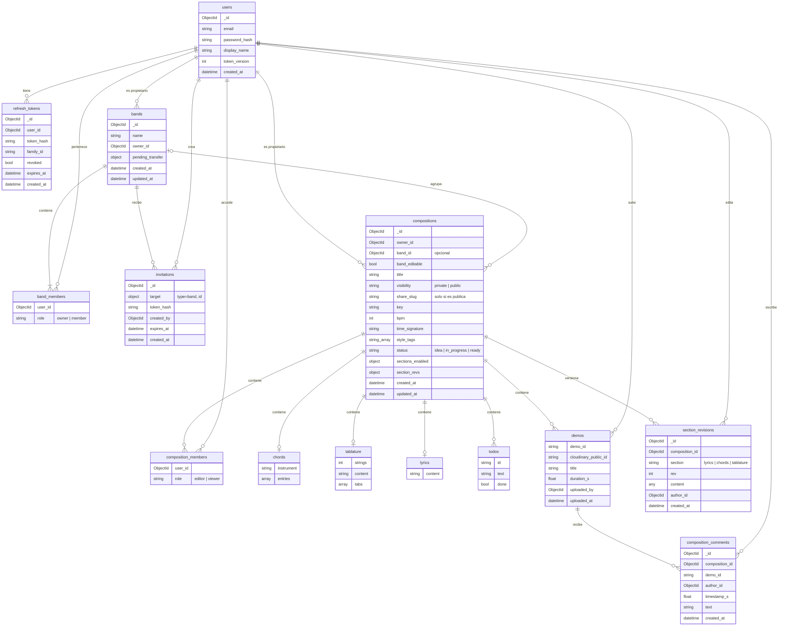

# Arquitectura de la base de datos de Erato

Modelo de entidades y relaciones de la base MongoDB actual (rama `preview`, 2026-10-11).

## Entidades

| Entidad | Tipo | Descripción |
| --- | --- | --- |
| `users` | Colección | Cuentas de usuario |
| `refresh_tokens` | Colección | Sesiones de un usuario |
| `bands` | Colección | Grupos de usuarios |
| `band_members` | Embebida en `bands` | Pertenencia de un usuario a una banda, con rol |
| `invitations` | Colección | Invitaciones para unirse a una banda |
| `compositions` | Colección | Canciones de la banda o de un usuario |
| `composition_members` | Embebida en `compositions` | Acceso explícito de un usuario a una composición, con rol |
| `chords`, `tablature`, `lyrics` | Embebidas en `compositions` | Secciones de contenido opcionales |
| `todos` | Embebida en `compositions` | Tareas de la composición |
| `demos` | Embebida en `compositions` | Audios de la composición (el archivo vive fuera de MongoDB) |
| `composition_comments` | Colección | Comentarios anclados a un instante de un demo |
| `section_revisions` | Colección | Versiones guardadas de una sección de contenido |

## Diagrama

## Relaciones

| Origen | Destino | Cardinalidad | Cómo se representa |
| --- | --- | --- | --- |
| `users` | `refresh_tokens` | 1 a N | `refresh_tokens.user_id` |
| `users` | `bands` | 1 a N (propietario) | `bands.owner_id` |
| `users` | `bands` | N a N (miembros) | `bands.members[].user_id` |
| `bands` | `invitations` | 1 a N | `invitations.target.id` |
| `users` | `invitations` | 1 a N (creador) | `invitations.created_by` |
| `users` | `compositions` | 1 a N (propietario) | `compositions.owner_id` |
| `users` | `compositions` | N a N (acceso explícito) | `compositions.members[].user_id` |
| `bands` | `compositions` | 0..1 a N | `compositions.band_id` |
| `compositions` | secciones, `todos`, `demos` | 1 a N, embebidas | Subdocumentos dentro de `compositions` |
| `compositions` | `composition_comments` | 1 a N | `composition_comments.composition_id` |
| `demos` | `composition_comments` | 1 a N | `composition_comments.demo_id` (identificador de texto del demo embebido) |
| `compositions` | `section_revisions` | 1 a N | `section_revisions.composition_id` + `section` |
| `users` | `composition_comments`, `section_revisions`, `demos` | 1 a N (autor) | `author_id` / `uploaded_by` |

Las referencias son `ObjectId` guardados en el documento; MongoDB no impone integridad referencial entre colecciones.
